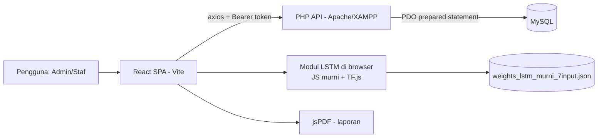
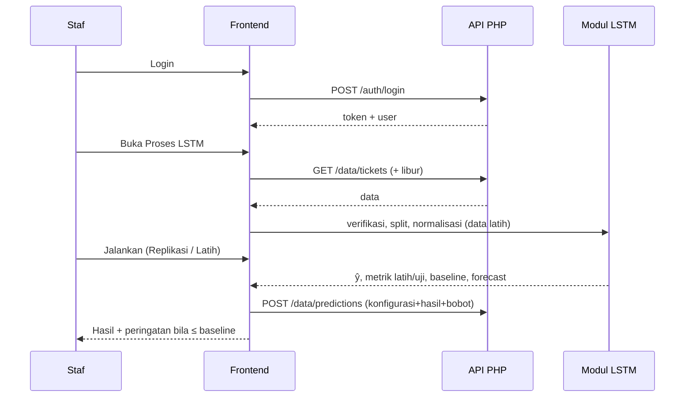
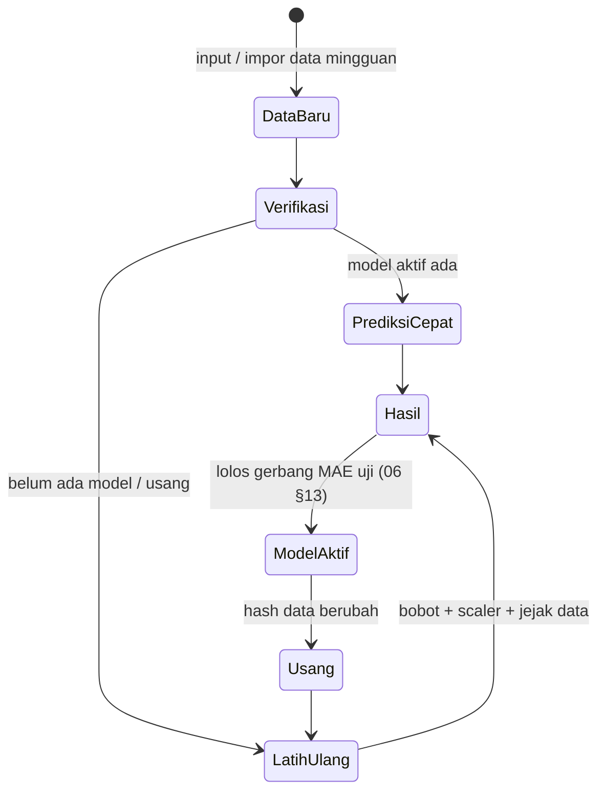

# SDD — Arsitektur & Desain Teknis (SWA Predict)

## 1. Gambaran arsitektur



**Prinsip:** (1) logika model berupa fungsi murni di sisi klien, (2) server hanya menyimpan data & riwayat serta menegakkan autentikasi, (3) seluruh konfigurasi dari `.env`.

## 2. Struktur folder target

```
prediksi-lstm/
├─ api/
│  ├─ config/            db.php, env.php, auth.php, response.php   (tanpa kredensial)
│  ├─ auth/              login.php, register.php (admin), me.php
│  ├─ data/              tickets.php, predictions.php, holidays.php
│  ├─ user/              profile.php
│  ├─ migrations/        001_*.sql … (lihat 04)
│  └─ .env.example
├─ src/
│  ├─ services/
│  │  ├─ api.js                      axios + interceptor token/401
│  │  └─ lstm/                       (hasil pemecahan lstm.js — T-10)
│  │     ├─ preprocessing.js         normalisasi, fitur, windowing, split
│  │     ├─ lstmCell.js              forward pass murni (replikasi)
│  │     ├─ trainer.js               mode Latih (TF.js)
│  │     ├─ trainer.worker.js        Web Worker pelatihan (tidak memblokir UI)
│  │     ├─ retrainOrchestrator.js   job otomatis, champion–challenger, gerbang MAE
│  │     ├─ metrics.js               MAE/MSE/RMSE/MAPE, baseline, korelasi
│  │     ├─ forecast.js              peramalan multi-langkah
│  │     └─ index.js
│  ├─ models/weights_lstm_murni_7input.json
│  ├─ pages/ …                       (tetap)
│  └─ __tests__/                     vitest + golden test
├─ docs/                             paket dokumen ini
├─ .env.example                      VITE_API_URL=
└─ database.sql                      skema dasar (+ api/migrations)
```

## 3. Komponen & tanggung jawab

| Komponen | Tanggung jawab | Catatan |
|---|---|---|
| `Layout.jsx` | Navigasi, tema, logout | Hapus `token/user` saat 401 |
| `DataInput.jsx` | CRUD, impor/ekspor CSV | Kolom Harga & Libur |
| `LstmProcess.jsx` + `Step1..3` | Wizard: verifikasi → konfigurasi → pelatihan/hasil | Pisahkan logika dari tampilan |
| `Report.jsx` | Riwayat & PDF | Tambah baseline & metrik uji |
| `Dashboard.jsx` | Ringkasan & grafik | Ambil prediksi dari riwayat terakhir |
| `api/config/auth.php` | Terbit/verifikasi token, `require_auth()`, `require_role()` | HS256, `hash_hmac` |
| `api/config/response.php` | Format respons seragam + penanganan galat | Tanpa *stack trace* |

## 4. Alur utama



## 5. Keputusan arsitektur (ADR)

| ID | Keputusan | Alasan | Konsekuensi |
|---|---|---|---|
| ADR-01 | Perbaiki repo yang ada (React + PHP), bukan rebuild | Keputusan pengguna; sistem sudah berjalan | Tetap JavaScript; tidak migrasi ke Express/Prisma |
| ADR-02 | Token **JWT HS256 buatan sendiri** (`hash_hmac`) tanpa Composer | XAMPP sederhana, tanpa dependensi | Wajib `hash_equals`, `exp`, secret ≥ 32 karakter dari `.env` |
| ADR-03 | Token di `localStorage` (status quo) | Sederhana untuk SPA lintas-port | Risiko XSS: escape output, tanpa `dangerouslySetInnerHTML`, CSP bila hosting |
| ADR-04 | Bobot Replikasi disajikan sebagai **berkas statis** di frontend | Tidak perlu endpoint; mudah diuji | Versi bobot ikut versi aplikasi |
| ADR-05 | Mode Latih memakai TF.js `tf.layers.lstm` (unit 4, `returnSequences:false`) | Sudah ada dependensi; BPTT otomatis | Bentuk input mengikuti OQ-01 |
| ADR-06 | SQLite fallback dipertahankan **hanya demo**, diaktifkan via `.env` (`DB_FALLBACK=sqlite`) | Menghindari fallback diam-diam | Default: galat jelas bila MySQL mati |
| ADR-07 | Kunci minggu = `week_start_date` (OQ-10) | "Minggu" Excel Rabu–Selasa, melintasi tahun | Migrasi `week`/`year` jadi kolom turunan |
| ADR-08 | Pelatihan di browser dalam **Web Worker** (wajib) | Data kecil; tanpa server ML; UI harus responsif | Batas waktu NFR-PERF-01/03 |
| ADR-09 | **Data dinamis:** tanpa dataset tetap; split berbasis rasio; scaler milik model; jejak data (`data_hash`) pada tiap hasil | Data bertambah/berubah lewat input pengguna | Status model terkini/usang; perlu `GET /data/summary` |
| ADR-10 | Dua jalur model: **Prediksi cepat** (inferensi dengan model aktif) dan **Pelatihan ulang otomatis** | Model harus mengikuti data tanpa menunggu tindakan pengguna | Bobot + scaler + konfigurasi tersimpan utuh |
| ADR-11 | **Champion–challenger:** model baru menggantikan hanya bila MAE uji ≤ champion pada **jendela uji yang sama** | Pelatihan ulang tidak menjamin akurasi naik; gerbang mencegah kemunduran | Seleksi berulang pada data uji bersifat optimis → wajib *galat nyata* |
| ADR-12 | Antrean job di DB (`training_jobs`) dengan kunci tunggal + detak | Pelatihan di browser; banyak tab/pengguna | Endpoint job (`05 §3.3c`); tanpa server ML |
| ADR-13 | Dua kandidat: **dari nol** dan **lanjutan** (scaler aktif dibekukan untuk lanjutan) | Bandingkan stabilitas vs kecepatan; bobot lama hanya bermakna pada skala lamanya | Waktu job ±2× satu pelatihan |

## 5b. Siklus hidup data & model



- **Hash kanonik:** SHA-256 dari baris terurut `week_start_date|tickets_sold|ticket_price|libur` (harga tanpa nol di belakang), dipisah `\n`, tanpa baris kosong di akhir. Fungsi yang sama dipakai klien dan server; nilai referensi di `assets/reference_data_hash.txt`.
- **Ringkasan data:** `GET /data/summary` → `n`, `first_week`, `last_week`, `last_updated`, `data_hash`, `gaps` (`05 §3.3b`).
- **Model aktif:** satu hasil bertanda `is_active` memakai bobot + scaler + konfigurasi tersimpan; Dashboard menghitung "Prediksi Minggu Depan" dari model aktif pada data terbaru, bukan angka lama.
- **Konsistensi:** data berubah saat pelatihan berjalan → hasil memakai hash saat mulai dan otomatis berstatus usang.

## 5c. Alur pelatihan ulang otomatis

```mermaid
sequenceDiagram
  participant U as Pengguna
  participant F as Frontend
  participant A as API (training_jobs)
  participant W as Web Worker
  U->>F: Simpan / impor / ubah / hapus data
  F->>A: simpan data
  F->>F: debounce 3 dtk (impor: sekali di akhir)
  F->>A: POST training-jobs (data_hash)
  A-->>F: job pending → klaim (running_key)
  F->>W: latih A (dari nol) lalu B (lanjutan)
  W-->>F: progres + detak (5 dtk)
  F->>F: evaluasi champion, A, B pada jendela uji W yang sama
  alt MAE uji kandidat ≤ champion
    F->>A: simpan kandidat, is_active=1, decision=diaktifkan
  else lebih buruk
    F->>A: simpan kandidat decision=ditahan; champion tetap
  end
  F-->>U: status + keputusan + galat nyata
```

- **Antrean:** satu job `running` global; job baru membatalkan job lama (hash terbaru menang).
- **Pemulihan:** saat aplikasi dibuka, cari job `pending`/basi dan lanjutkan.
- **Kegagalan:** job `gagal`, model aktif tak berubah.

## 6. Desain keamanan

- **Autentikasi:** `Authorization: Bearer <JWT>`; payload `{sub, role, iat, exp}`; `require_auth()` dipanggil di baris pertama setiap endpoint non-publik.
- **Otorisasi:** `require_role('admin')` untuk register, reset/hapus massal, kelola kalender, hapus semua riwayat.
- **CORS:** `ALLOWED_ORIGINS` dari `.env`; balas `Access-Control-Allow-Origin` hanya bila origin cocok.
- **Kredensial:** `DB_HOST/DB_NAME/DB_USER/DB_PASS/JWT_SECRET` dari `api/.env` (di-`.gitignore`); user DB khusus dengan hak minimum.
- **Input:** validasi tipe & rentang; simpan data mentah, *escape* di UI; larang `TRUNCATE` dari HTTP.
- **Berkas:** `test_db.php` dihapus dari repo; `.gitignore` mencakup `.env`, `*.sqlite`, `dist/`.

## 7. Penanganan galat & log

- Format galat seragam (`05 §2`); server mencatat detail ke `error_log` PHP, klien hanya menerima pesan aman.
- Frontend: interceptor axios — 401 → logout + arahkan ke `/login`; 403 → toast "Tidak berhak"; 422 → tampilkan galat per kolom; jaringan gagal → status "Server tidak terjangkau".

## 8. Deployment lokal (XAMPP)

1. Salin repo ke `htdocs/prediksi-lstm`; buat `api/.env` dari `.env.example`.
2. Buat database & user, jalankan `database.sql` lalu `api/migrations/*.sql` berurutan.
3. Buat admin awal: `php api/setup/create_admin.php` (T-02).
4. Frontend: `.env` → `VITE_API_URL=http://localhost/prediksi-lstm/api`; `npm run dev` atau `npm run build` lalu sajikan `dist/`.
