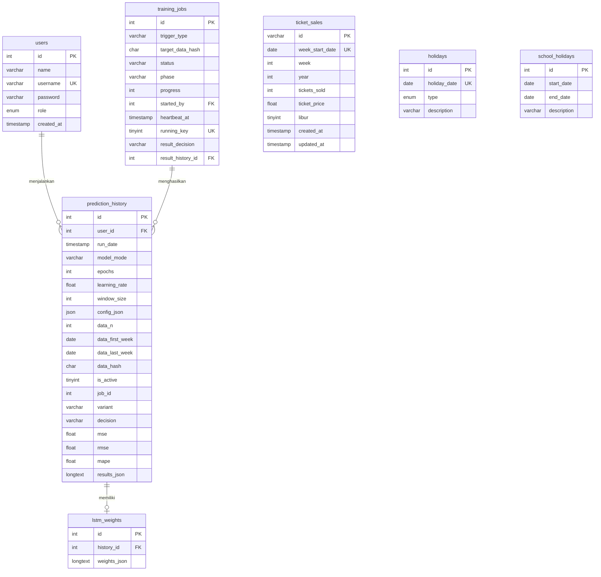

# Desain Database — SWA Predict

**DBMS:** MySQL 8 / MariaDB 10.4 (XAMPP), charset `utf8mb4`. SQLite hanya fallback demo (ADR-06).
**Skema saat ini:** `database.sql` (4 tabel). **Skema target:** skema saat ini + migrasi `api/migrations/001…004` di bawah.

## 1. ERD (target)

`ticket_sales`, `holidays`, `school_holidays` bersifat global (satu perusahaan); `prediction_history.user_id` mencatat siapa menjalankan.

## 2. Kamus data

### 2.1 `users`
| Kolom | Tipe | Null | Aturan |
|---|---|---|---|
| id | INT AI | tidak | PK |
| name | VARCHAR(100) | tidak | 2–100 karakter |
| username | VARCHAR(50) | tidak | unik, 3–50 karakter, tanpa spasi |
| password | VARCHAR(255) | tidak | hasil `password_hash`; panjang asli ≥ 8 |
| **role** *(baru)* | ENUM('admin','staf') | tidak | default `staf` |
| created_at | TIMESTAMP | tidak | default now |

### 2.2 `ticket_sales`
| Kolom | Tipe | Null | Aturan |
|---|---|---|---|
| id | VARCHAR(50) | tidak | PK, format `tiket-YYYYMMDD-NNN` (status quo) |
| **week_start_date** *(baru, kunci)* | DATE | tidak | **unik**; awal minggu Rabu–Selasa (OQ-10) |
| week | INT | tidak | nomor minggu dalam tahun; **turunan** dari `week_start_date` |
| year | INT | tidak | turunan |
| tickets_sold | INT | tidak | ≥ 0 |
| ticket_price | FLOAT | tidak | ribu Rupiah, **harga mentah** (> 0) — OQ-09 |
| **libur** *(baru)* | TINYINT(1) | tidak | 0/1; default hasil turunan kalender, boleh ditimpa |
| **updated_at** *(baru)* | TIMESTAMP | tidak | `ON UPDATE CURRENT_TIMESTAMP`; dasar ringkasan perubahan data |
| created_at | TIMESTAMP | tidak | default now |

Catatan: `sale_date` lama dipetakan ke `week_start_date`. `UNIQUE(week, year)` lama diganti `UNIQUE(week_start_date)`.

### 2.3 `holidays` *(baru)*
| Kolom | Tipe | Aturan |
|---|---|---|
| id | INT AI | PK |
| holiday_date | DATE | unik |
| type | ENUM('nasional','cuti_bersama') | |
| description | VARCHAR(150) | mis. "Idul Fitri 1446 H" |

### 2.4 `school_holidays` *(baru)*
| Kolom | Tipe | Aturan |
|---|---|---|
| id | INT AI | PK |
| start_date, end_date | DATE | `end_date ≥ start_date` |
| description | VARCHAR(150) | mis. "Libur kenaikan kelas 2025 (Jatim)" |

### 2.5 `prediction_history`
| Kolom | Tipe | Keterangan |
|---|---|---|
| id | INT AI | PK |
| **user_id** *(baru)* | INT NULL FK→users | `ON DELETE SET NULL` |
| run_date | TIMESTAMP | |
| **model_mode** *(baru)* | VARCHAR(20) | `replikasi` \| `latih` |
| epochs, learning_rate, window_size | INT/FLOAT | `window_size` = 1 untuk model 7 input (OQ-01) |
| **config_json** *(baru)* | JSON | hidden unit, seed, rasio split, rentang minggu latih/validasi/uji, min/max normalisasi |
| **data_n, data_first_week, data_last_week** *(baru)* | INT, DATE, DATE | Jejak data saat hasil dibuat |
| **data_hash** *(baru)* | CHAR(64) | SHA-256 kanonik (`03 §5b`); bandingkan dengan data sekarang → terkini/usang |
| **is_active** *(baru)* | TINYINT(1) | Hanya satu baris `1`; model yang dipakai Prediksi cepat & Dashboard |
| **job_id** *(baru)* | INT NULL FK→training_jobs | Job pelatihan yang menghasilkan baris ini |
| **variant** *(baru)* | VARCHAR(12) | `scratch` \| `warm` \| `manual` \| `replikasi` |
| **decision** *(baru)* | VARCHAR(20) | `diaktifkan` \| `ditahan` \| `tanpa_champion` (alasan + MAE champion pada jendela sama ada di `results_json`) |
| mse, rmse, mape | FLOAT | **metrik data uji** |
| results_json | LONGTEXT | aktual vs prediksi, metrik latih, baseline naif & rata-rata, korelasi, forecast, **scaler**, **salinan seri data** (≤ 2.000 baris: tanggal, tiket, harga, libur) agar hasil dapat direproduksi walau data berubah |

### 2.6 `lstm_weights`
| Kolom | Tipe | Keterangan |
|---|---|---|
| id | INT AI | PK |
| history_id | INT FK | `ON DELETE CASCADE` |
| weights_json | LONGTEXT | struktur sama dengan `assets/weights_lstm_murni_7input.json` |

### 2.7 `training_jobs` *(baru, T-44)*
| Kolom | Tipe | Aturan |
|---|---|---|
| id | INT AI | PK |
| trigger_type | VARCHAR(12) | `simpan` \| `impor` \| `ubah` \| `hapus` \| `manual` \| `pemulihan` |
| target_data_hash | CHAR(64) | hash data yang dilatih |
| status | VARCHAR(12) | `pending` \| `running` \| `done` \| `failed` \| `cancelled` |
| phase | VARCHAR(12) NULL | `scratch` \| `warm` \| `evaluasi` |
| progress | TINYINT | 0–100 |
| started_by | INT NULL FK→users | `ON DELETE SET NULL` |
| created_at, started_at, heartbeat_at, finished_at | TIMESTAMP NULL | detak tiap 5 dtk; basi bila > 60 dtk |
| **running_key** | TINYINT NULL **UNIQUE** | 1 saat `running`, NULL selain itu → menjamin satu job berjalan |
| error_message | VARCHAR(255) NULL | pesan aman |
| result_decision | VARCHAR(20) NULL | ringkasan keputusan |
| result_history_id | INT NULL FK→prediction_history | kandidat pemenang |

## 3. Migrasi (berkas bernomor, idempoten bila memungkinkan)

| Berkas | Isi |
|---|---|
| `001_users_role.sql` | `ALTER TABLE users ADD COLUMN role ENUM('admin','staf') NOT NULL DEFAULT 'staf';` |
| `002_ticket_sales_week_start.sql` | Tambah `week_start_date`, `libur`; isi dari `sale_date`; hapus `UNIQUE(week,year)`; tambah `UNIQUE(week_start_date)` |
| `003_holidays.sql` | Buat `holidays`, `school_holidays` + seed kalender 2025–2026 (dari Excel) |
| `004_history_columns.sql` | Tambah `user_id`, `model_mode`, `config_json`, `data_n`, `data_first_week`, `data_last_week`, `data_hash`, `is_active`, `job_id`, `variant`, `decision` ke `prediction_history` |
| `005_training_jobs.sql` | Buat `training_jobs` (kunci tunggal job berjalan via `running_key` UNIQUE) |

Aturan: jangan menghapus kolom lama sebelum data dipindah; sediakan skrip `down` bila memungkinkan; jalankan di salinan data dulu.

## 4. Seed

- **Data penjualan:** `assets/dataset_67_minggu.json` (67 minggu, 1 Jan 2025–14 Apr 2026, kolom `libur`) hanya **seed demo opsional dan fixture uji** — data produksi berasal dari input pengguna (dinamis; OQ-07). `api/config/excel_data.json` (2023–2024) dihapus dari seed.
- **Kalender libur:** dari lembar "Kalender Libur" Excel (tanggal merah/cuti bersama 2025–2026; libur sekolah Jatim: kenaikan kelas 1–12 Jul 2025, semester ganjil 22 Des 2025–3 Jan 2026, sekitar Idul Fitri 20–28 Mar 2026).
- **Pengguna:** tidak ada seed kata sandi. Admin dibuat via `api/setup/create_admin.php`.

## 5. Aturan integritas & indeks

- `UNIQUE(ticket_sales.week_start_date)`, indeks `(year, week)`, `(week_start_date)`.
- Hapus riwayat → `lstm_weights` ikut terhapus (cascade).
- Seluruh impor/ubah massal dalam satu transaksi.
- `TRUNCATE` tidak boleh dipanggil dari endpoint HTTP; gunakan `DELETE` di dalam transaksi + hak admin.
- Hanya satu `training_jobs` berstatus `running` (`running_key` UNIQUE); job tanpa detak > 60 dtk boleh diambil alih. Hanya satu `prediction_history.is_active = 1`.
